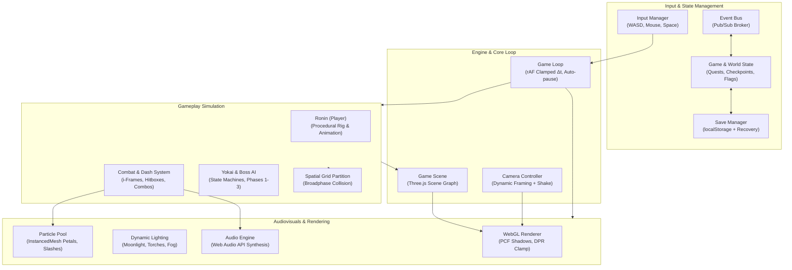
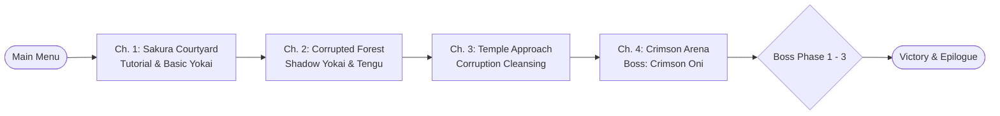

# ⛩️ Shadow of the Crimson Gate

[](https://www.typescriptlang.org/)
[](https://threejs.org/)
[](https://vitejs.dev/)
[](LICENSE)

> A cinematic Japanese dark fantasy action game built entirely with **Three.js** and **TypeScript**. Features real-time katana combat, multi-phase boss encounters, dynamic atmospheric shaders, and procedural 3D geometry without external model dependencies.

---

## 🏛️ System Architecture



---

## 🎮 Game Progression Flow



---

## ⚡ Core Technical Highlights

| Component | Technical Implementation |
|---|---|
| **Procedural World** | 100% code-generated 3D geometry (Ronin rig, Yokai, Shrines, Torii gates, flora). No external model files. |
| **Real-Time Combat** | Frame-accurate katana combos, dodge roll invulnerability windows (`i-frames`), and reactive knockback. |
| **Boss State Machine** | 3 distinct combat phases for the *Crimson Oni* featuring sweeping blade arcs, ground slams, and arena fire hazards. |
| **Camera** | Third-person orbit camera with auto-follow, combat framing, dialogue two-shots, cinematic sequences, and fading of anything that blocks the view. |
| **Rendering** | HDR post-processing (ambient occlusion, bloom, tone mapping, colour grade, vignette, film grain), moonlit follow shadows, a pooled set of real lamp lights, procedural sky and image-based lighting. |
| **Audiovisuals & FX** | Layered Web Audio mixing with zone ambience. GPU-accelerated `InstancedMesh` particles, grass and path stones. |
| **Engine Optimizations** | Spatial grid collision partitioning, DPR clamp (max 2.0), delta-time clamping (100ms cap), and tab-blur auto-pause. |

---

## 🕹️ Controls

| Action | Primary Input | Secondary / Alternate |
|---|---|---|
| **Movement** | `W` `A` `S` `D` | Arrow keys |
| **Camera** | Move mouse (click the game to capture it) | Hold right mouse and drag |
| **Sprint** | `Shift` | — |
| **Katana Strike** | `Left Click` | `J` |
| **Dash / Dodge** | `Space` | — |
| **Interact (Shrines, NPCs)** | `E` | — |
| **Pause Menu** | `Escape` | — |

---

## 🚀 Quick Start

### Prerequisites
- Node.js (v18.0 or newer)
- npm or pnpm

### Installation & Run

```bash
# Clone the repository
git clone https://github.com/MdKasif0/Shadow-of-the-Crimson-Gate.git
cd "Shadow of the Crimson Gate"

# Install dependencies
npm install

# Start local dev server (http://localhost:5173 or :3000)
npm run dev

# Create optimized production build
npm run build

# Preview production build locally
npm run preview
```

---

## ⚙️ Performance & Accessibility Settings

The in-game settings modal allows full real-time customization:
- **Graphics Quality**: Low / Medium / High (adjusts resolution, shadows, lamp lights, bloom and ambient occlusion). The game also scales quality down automatically if the frame rate stays low.
- **VFX Density**: Low / Medium / High (adjusts particle pool batch count)
- **Camera Shake & Motion Reduction**: Configurable toggles for accessibility
- **Audio Mixers**: Independent Master and Ambient/SFX sliders

---

## 📄 License

This project is open-source and released under the [MIT License](LICENSE).  
Copyright (c) 2024–2026 **Md Kasif Uddin**.
